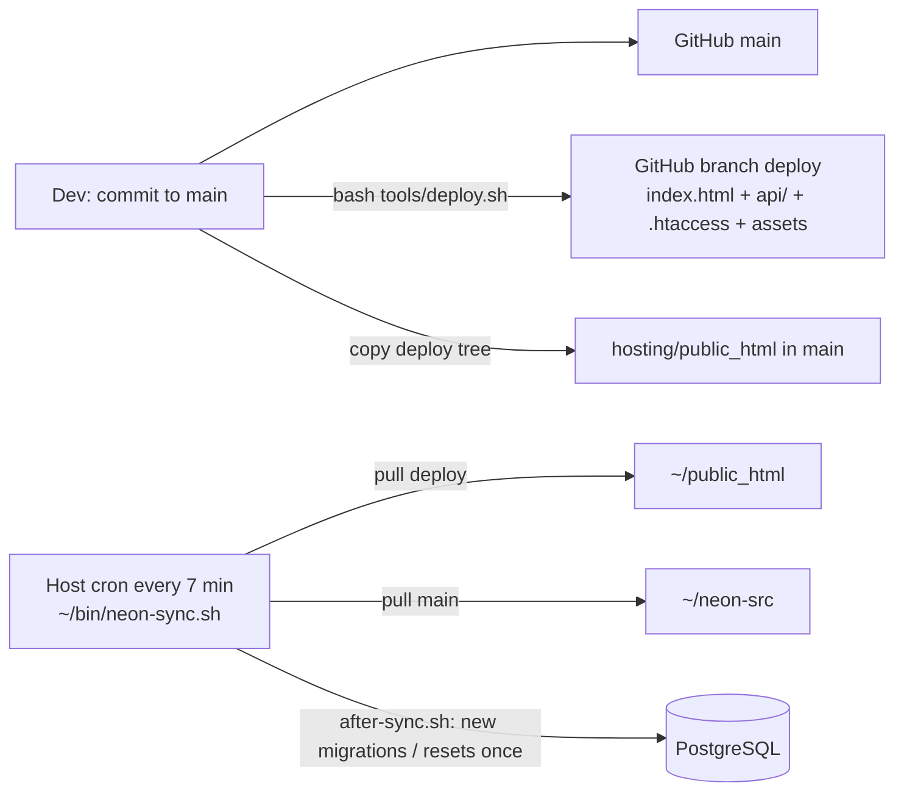

# Architecture

Verified against the code at commit `2afcd46` (2026-10-12), audit 2026-10-17 (E-17, E-18).

## Stack (verified)

| Layer | Technology | Where |
|---|---|---|
| UI | React 18.3, react-router-dom 6.28 (**HashRouter**, links are `/#/route`), zustand 5, framer-motion 11, lucide-react, clsx | `package.json`, `src/` (~32.5k lines) |
| Styling | Tailwind 3 + a large hand-written `src/index.css` (design tokens, light/dark/potato, card faces `lc-*`) | `tailwind.config.js`, `src/index.css` |
| Build | **Custom bundler** `tools/standalone/build.mjs` → one HTML file `dist/neon-arcade-standalone.html`; React, router, framer-motion, lucide load as UMD from a CDN. Vite config exists but is **not** the production build. | `tools/standalone/build.mjs` |
| API | Plain **PHP 8.1** (no framework). Router `api/index.php` → `api/lib/*.php` (~8.6k lines) | `api/` |
| Database | **PostgreSQL 16** on the same host. `db/schema.sql`, `db/functions.sql` (wallet ledger, game start, flags, admin SQL functions), `db/compat.sql` (host has no pgcrypto/citext), 28 migrations | `db/` |
| Mail | `api/lib/mail.php` (password reset, email verification, 2FA codes) via the host's mail | `api/lib/mail.php` |
| Hosting | DomaiNesia shared cPanel (plan `nimbus_go`), domain `arcadebet.my.id` | E-10 |
| Real-time | Polling (sync every 15 s, 4 s in chat, `/pulse` for live game updates). No WebSocket. | `src/services/server.js` |

## Two run modes

`src/config/runtime.js`: when `index.html` sets `window.NEON_API = '/api'` (production does), `SERVER_MODE = true` and the
UI calls the PHP API. Without it the app runs the old **local mode**: `src/services/*.js` simulate the backend in
`localStorage` (phase 1–6 era). New features since stage 2 are server-only; local mode is kept for the artifact and tests.

## Request flow

```mermaid
flowchart LR
  B[Browser SPA<br/>src/] -- "fetch /api/... (cookie, X-Neon: 1)" --> R[api/index.php route()]
  R --> L[api/lib/*.php]
  L -- "q()/tx() PDO" --> P[(PostgreSQL<br/>arcadebe_neon)]
  L --> M[mail.php]
  B -- "poll sync / pulse" --> R
```

- Every POST must carry header `X-Neon: 1` (CSRF guard, `api/index.php` ~line 309).
- Session = HttpOnly cookie, SameSite=Lax. Absolute lifetime 7 days (`SESSION_TTL_S`, `auth.php`), 3 hours in strict mode (`SESSION_STRICT_S`, `security.php`).
- Errors: `fail('some.i18n.key', vars, status)` throws `ApiError`; the router returns `{ok:false,error:{code,vars}}`; the UI translates `code` with i18n.

## API library map (`api/lib`, lines)

| File | Lines | Responsibility |
|---|---|---|
| `core.php` | 198 | config (`~/neon-config.php`), PDO, `tx()`, `fail()`, `q/q1/qv` helpers |
| `auth.php` | 291 | register/login, sessions, `me_payload`, profile |
| `security.php` | 399 | 2FA (TOTP RFC 6238 + email codes), login challenge, strict sessions, AES-GCM secret storage |
| `account.php` | 159 | forgot/reset password, email verification, change email |
| `state.php` | 212 | wallet wrapper over SQL `wallet_post`, notify, user view |
| `progression.php` | 518 | XP, levels, quests, daily, achievements, seasons |
| `games.php` / `games2.php` | 729 / 535 | all wagered games, begin/finish, crash (solo + global), cases, battles, new games |
| `chess.php`, `arcade.php` | 308 / 107 | Chess PvP + practice engine; skill arcades (score checks, capped payouts) |
| `platform.php`, `platform2.php`, `platform3.php` | 707 / 800 / 638 | sync view, tickets, announcements view, catalog, loyalty, memberships, perks, pass, shop, KV config (`kv_get`, `KV_DEFAULTS`) |
| `admin.php`, `admin2.php` | 595 / 458 | admin snapshot + actions |
| `v2core.php` | 874 | feature flags, targeted announcements, session termination, economy analytics, captcha (PoW/Turnstile), crash curve, QA checks, `admin_v3_action`, `admin_v4_action` |
| `console.php`, `console2.php` | 355 / 418 | Owner Console: key auth, sessions, command registry, audit; catalog of every admin action, field parsing, prepare step |
| `rng.php` | 99 | provably-fair HMAC-SHA256 RNG (identical to JS, checked by `api/tests/rng_compare.mjs`) |

**Admin dispatch order** (`admin.php` `admin_action`): `admin_v3_action` (v2core) → `admin_v2_action` (admin2) → own switch → some cases forward to `admin_v4_action`. A name handled earlier hides later handlers (example: E-29).

## Frontend map

- `src/App.jsx` — all routes. Player: `/`, `/games`, `/games/:slug`, `/jackpot`, `/chat`, `/wallet`, `/redeem`, `/profile`, `/settings`, `/rewards`, `/shop`, `/loyalty`, `/membership`, `/pass`, `/history(/:id)`, `/leaderboard`, `/friends`, `/inventory`, `/u/:username`, `/notifications`, `/support(/:id)`. Public: `/auth`, `/status`, `/reset-password`, `/verify-email`, `/system-console`.
- Admin (`/admin/*`, `src/admin/AdminLayout.jsx`, pages in `src/admin/pages/`): dashboard, analytics, logs, users, wallets, loyalty, player-roles, memberships, economy, games, sessions, anticheat, testmode, moderation, reports, chat, chat-filter, restrictions, support, announcements, rewards, daily, quests, achievements, missions, codes, shop, emotes, system, features, monitoring, qa, settings.
- Stores (`src/store`): auth, wallet, progress, platform, prefs, notifications, ui, admin, fairness, extras.
- `src/services/server.js` — `api()` client: adds `X-Neon`, solves the captcha on auth paths, handles 401/banned, runs `sync()`.
- Games: `src/config/games.js` registers 23 slugs (22 playable; `reme` has no loader). Shared bet UI in `src/components/play/GameKit.jsx`.
- i18n: `src/i18n/en.js`, `id.js` plus `phase4…phase13` files deep-merged. Every new key must exist in both languages (`tests/i18n-keys.mjs`).

## Authorization

- Roles (DB enum): `super_admin` (Owner, green tag), `admin` (red), `moderator` (yellow), `support` (Helper, blue), `developer` (Tester, orange), `user`.
- Fine-grained permissions in DB table `role_permissions`, checked by `require_user_perm()`; mirrored in `src/config/roles.js` for the UI. **Three places to keep in sync** (DB, PHP calls, JS map).
- `adm_target()` stops staff acting on equal or higher roles. The Owner Console actor bypasses rank checks; `console_do_actor()` uses a sign-in-proof system account `neon_console` so SQL functions that need a staff id work.

## Data integrity

- All balance changes go through SQL `wallet_post` with a unique `(user_id, idempotency_key)`; refunds use `refund:<session>`.
- Game rounds start with SQL `game_start`; settle once.
- Config that admins can change lives in `neon_kv` (`economy`, `moderation`, `memberships`, `crash`, `bots`, `release`, `captcha`, `luck`) merged over `KV_DEFAULTS`.
- Release resets (`db/resets/*`, `release_reset()`) restore every balance to 10,000 AC + 1 AG and wipe progress — **only after the owner chooses it**.

## Deployment flow


Details and commands: `REPOSITORY_AND_DEPLOYMENT.md`.
