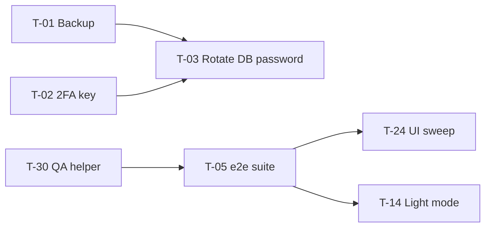

# Master Backlog

The **only** list of outstanding work. Audit 2026-10-17. Older lists (`docs/ROADMAP.md`, `docs/MASTER-UPDATE.md`) are history.
Ranking: security/data → production stability → user-facing defects → explicit requests → completeness → UI/UX → maintainability → optional.
**Origin** says whether the owner asked for it (REQUESTED), it was promised/planned (PLANNED), or Claude suggests it (SUGGESTED — needs approval).
Effort: S (< 1 h), M (half day), L (1–2 days), XL (more).

## Do first when development resumes (or before the hosting lapses)

| ID | Title | Category | Origin | Prio | Effort | Depends | Acceptance / Definition of done | Next action |
|---|---|---|---|---|---|---|---|---|
| T-01 | Back up the production database off the host | Critical / data | SUGGESTED (preservation duty) | **P0** | S | owner approval | A `pg_dump` file + `neon-config.php` copy stored offline; entry in `DATA_PRESERVATION.md` backup log | Owner runs the command in `DATA_PRESERVATION.md` |
| T-02 | Decouple 2FA key from DB password (SEC-02 / BUG-020) | Security | SUGGESTED | P1 | M | — | `twofa_key` in config; secrets re-encrypted; stage9 test: changing `db.pass` keeps 2FA working | Code change + one-off re-encrypt script, deploy |
| T-03 | Rotate DB password (BUG-002) | Security | PLANNED (owner action since 2026-10-10) | P1 | S | **T-02** | Old password no longer works; `/api/health` db:true | Owner in cPanel |
| T-04 | Check live VIP/VVIP prices and benefits (BUG-010) | Data integrity | SUGGESTED | P1 | S | console access | Prices/benefits are the intended values | Owner opens Membership page or console `audit` |
| T-05 | Re-run the browser e2e suite and fix BUG-012 | Testing | PLANNED (ROADMAP T1) | P2 | M | — | `bash tests/run-server-mode.sh` all green | Run it |
| T-06 | Verify 1.1.1 features on production: email 2FA delivery, authenticator, strict session, console forms | Testing | SUGGESTED | P2 | S | owner test account | Each works on arcadebet.my.id | Owner + Claude checklist from `TESTING_AND_VERIFICATION.md` |

## Bugs and small fixes

| ID | Title | Prio | Effort | Acceptance |
|---|---|---|---|---|
| T-10 | Console membership price label AG → Rp (BUG-017) | P3 | S | Label correct |
| T-11 | Changelog date 3.1.1 → 2026-10-12 (BUG-016) | P3 | S | — |
| T-12 | Whitelist dynamic i18n prefix after checking keys (BUG-019) | P3 | S | i18n check clean |
| T-13 | Vivace card key strip (BUG-009) | P3 | S | Visual check at card sizes |
| T-14 | Light-mode sweep of remaining dark panels (BUG-004) | P2 | M | Screenshots readable in light mode, every page |
| T-15 | Trailer "seen" stored on the server (BUG-018) | P3 | S | Same account, new device: no repeat | 

## Incomplete or requested features

| ID | Title | Origin | Status | Effort | Notes |
|---|---|---|---|---|---|
| T-20 | Racing PvP | PLANNED (MASTER-UPDATE G) | not started | XL | Needs shared-round design like Horse/Chess |
| T-21 | Reme game | PLANNED (phase 4 placeholder) | not started | L | Card game, rules not specified — ask owner |
| T-22 | Re-enable Layer and Moles | PLANNED ("for now" disabled) | disabled | M | Find why they were disabled (not in repo) |
| T-23 | Music on mobile — real device test | PLANNED (ROADMAP T11) | done-unverified | S | Tap test on iOS + Android |
| T-24 | Placeholder / icon / spacing / responsive sweep (admin + game pages) | PLANNED (ROADMAP T6) | partial | L | No raw keys, no overflow at 390 px |
| T-25 | Accessibility pass (focus, contrast, labels, reduced motion) | SUGGESTED | unknown | L | WCAG AA on main flows |
| T-26 | Turnstile keys for anti-bot | PLANNED (code ready) | config only | S | Owner adds keys; sign-up still works |

## Maintainability (suggested, need approval)

| ID | Title | Effort | Value |
|---|---|---|---|
| T-30 | Commit a QA helper (`tools/qa/serve.sh`) for a local server + fresh DB | S | Faster verification in every new session |
| T-31 | Test that DB `role_permissions` matches `src/config/roles.js` (TD-01) | S | Prevents hidden-button bugs |
| T-32 | Remove dead duplicate admin handlers (TD-02) | S | Less confusion |
| T-33 | Update `README.md`, drop stale root `neon-arcade-standalone.html`, fix `package.json` version/devDeps (TD-06, TD-07) | S | Correct first impression |
| T-34 | Add a CSP header (SEC-04) | M | Defence in depth; test carefully |
| T-35 | Login lock with IP dimension (SEC-05) | S | Prevents targeted lockouts |
| T-36 | Remove local demo mode from the production bundle (TD-03) | L | Smaller bundle — only if the artifact is retired |

## Deferred / dropped

- Football predictions — dropped (D-13). Do not re-propose without the owner.
- Real payment gateway for Top Up — deferred by design (D-01); memberships stay manual.
- WebSocket real-time — needs another host (D-05).

## Blocked

| Task | Blocked by |
|---|---|
| T-03 | T-02 and the owner |
| T-01, T-04, T-06, T-26 | Owner action / approval |
| Everything that costs hosting time | Financial suspension |

## Dependency map

## Needs the owner's explicit approval

T-01 (touches the host), T-02 (changes how 2FA secrets are stored), T-22 (re-enable games), T-34 (CSP may break pages), T-36, any release reset, any price/economy change.

## Recommended order when work resumes
T-01 → T-02 → T-03 → T-04 → T-30 → T-05 → T-06 → small fixes T-10…T-13 → T-14/T-24 → features.
